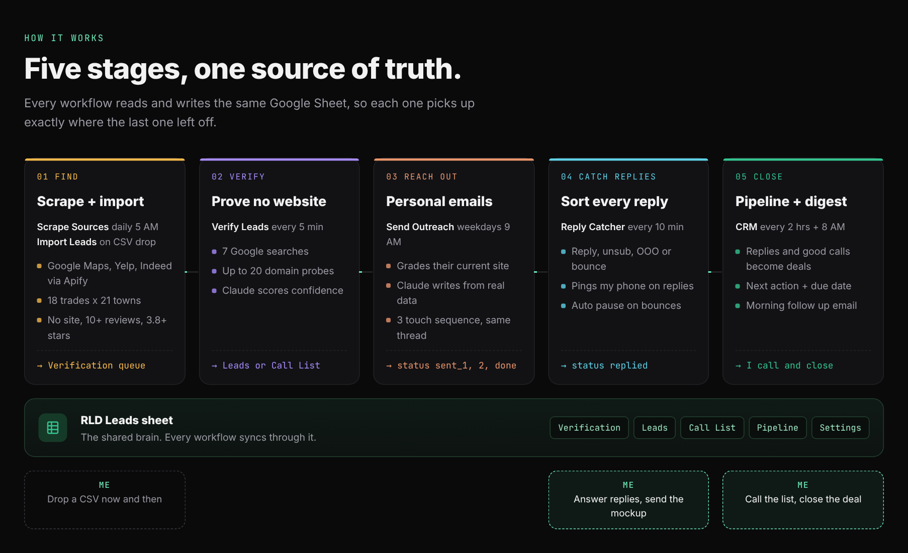
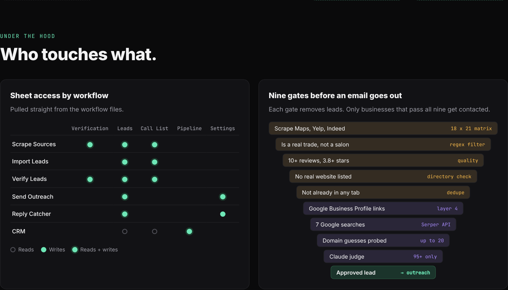
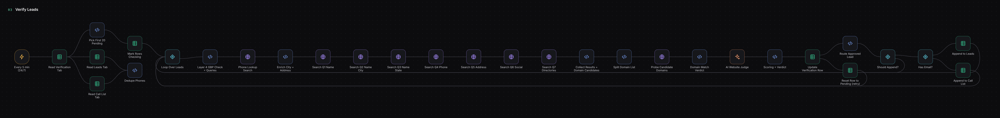
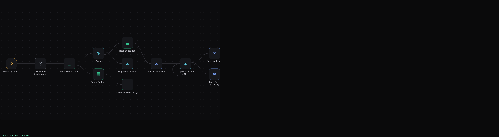

# RLD Outreach Engine

A lead gen and cold outreach system built in n8n. Six workflows and one Google Sheet that find local businesses with no website, prove they really have none, write each one a personal email with Claude, sort the replies and build a sales pipeline.

I built it to run my own agency, [Ron Lenser Digital](https://www.ronlenserdigital.com).

**[See the full visual breakdown](https://www.ronlenserdigital.com/work/outreach-engine)**

## The six workflows

| # | Workflow | Runs | What it does |
|---|---|---|---|
| 01 | [Scrape Sources](workflows/01-scrape-sources.json) | Daily 5 AM | Pulls contractors from Google Maps, Yelp and Indeed through Apify. Keeps real trades with 10+ reviews, 3.8+ stars and no real website. Dedupes and queues them for verification. |
| 02 | [Import Leads](workflows/02-import-leads.json) | Drive folder, every 5 min | Any Apollo or Maps CSV dropped in a Drive folder gets cleaned, deduped and filed. Email rows go to Leads, phone only rows go to the Call List. |
| 03 | [Verify Leads](workflows/03-verify-leads.json) | Every 5 min, 20 at a time | 7 Google searches through Serper, Google Business Profile check, up to 20 guessed domains probed, then Claude Haiku scores how sure it is there is no website. 95+ is approved. |
| 04 | [Send Outreach](workflows/04-send-outreach.json) | Weekdays 9 AM | Validates the email and MX record, grades the lead's current site, has Claude write a 3 email sequence from real lead data, runs a quality check on the copy, sends from Gmail and follows up in the same thread. |
| 05 | [Reply Catcher](workflows/05-reply-catcher.json) | Every 10 min | Matches each reply to a lead, sorts it into reply, unsubscribe, out of office or bounce, updates the sheet, forwards real replies and auto pauses outreach on 2+ bounces in a day. |
| 06 | [CRM](workflows/06-crm.json) | Every 2 hrs + 8 AM | Moves replies and interested calls into a Pipeline tab with a next action, then emails a morning list of follow ups due today. |

## Guardrails

- **Kill switch:** one cell in the Settings tab pauses every send
- **Bounce auto pause:** 2 bounces in a day flips the kill switch and sends an alert
- **Send ramp:** 5, 10, 15, then 20 emails a day by week, hard cap of 25
- **Human timing:** random 0 to 45 min start, random 1 to 3 min between sends
- **Copy quality gate:** no links, no dashes, no spam words, under 90 words, one rewrite then skip
- **Opt outs:** every email has an opt out line and mailing address, stop replies end the sequence

## Under the hood

### Verify Leads, node for node

### Send Outreach, node for node

More canvases are in [docs](docs).

## Stack

n8n · Claude Haiku 4.5 (Anthropic) · Google Sheets · Gmail · Google Drive · Apify (Google Maps, Yelp, Indeed) · Serper search API · PageSpeed Insights API · Google DNS · JavaScript

## Run it yourself

See [SETUP.md](SETUP.md). All credentials, sheet IDs and email addresses have been stripped from these files.

---

Built by Ronald Lenser with AI. [ronlenserdigital.com](https://www.ronlenserdigital.com)
